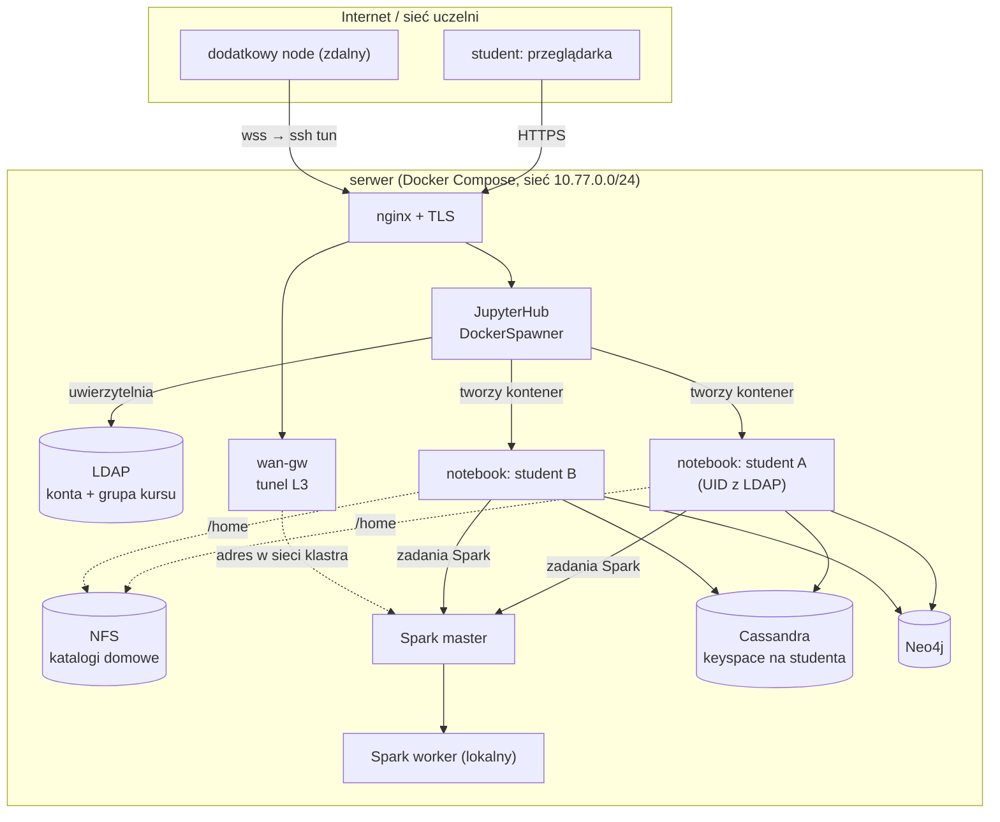
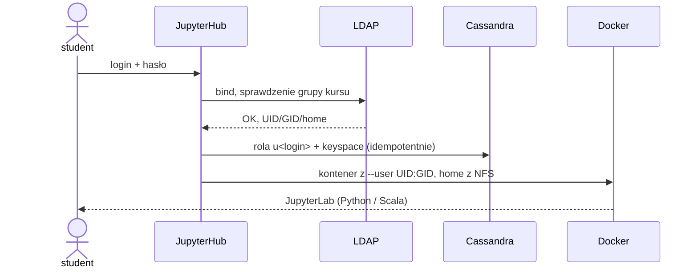
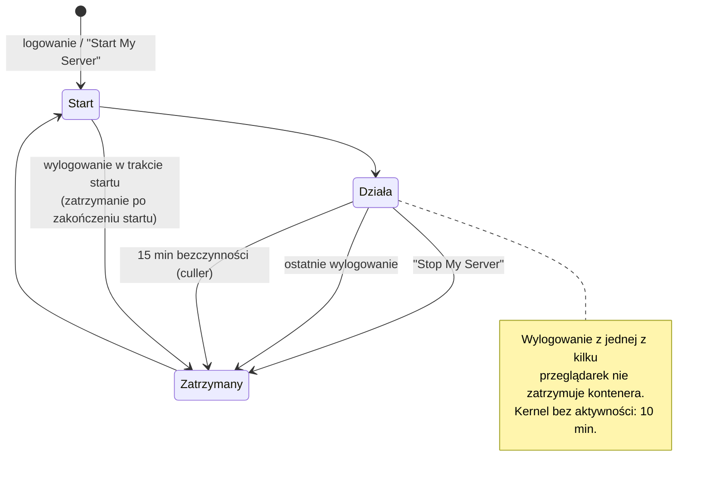
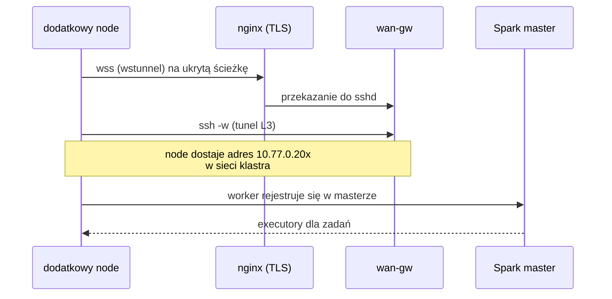

# PoC platformy Spark dla studentów: podsumowanie

Stan na 12.11.2026. Kod i instrukcja uruchomienia: to repozytorium (jedna komenda: `compose/demo.sh`, patrz rozdział 6). Poniżej opisuję, co zbudowałem, jak to działa, i co sprawdziłem.

## 1. Kontekst i cel

- **Cel:** postawić Spark 4 na nowej, czystej maszynie wirtualnej (Proxmox) do zajęć z chmur obliczeniowych, także jako podstawę przykładów na kolejną edycję kursu.
- **Wymagania ze specyfikacji:** na jednej instancji Spark, JupyterHub (Python i Scala, katalog na użytkownika), Cassandra i Neo4j. Do tego możliwość dołożenia drugiego node'a ze Sparkiem, wdrażanie z pipeline'ów GitLab i jak najmniej ręcznej pracy przy kontach kolejnych roczników.
- **Charakter raportu:** porównanie jakościowe podejść wdrożeniowych, bez benchmarków. Stary Spark 3 (CentOS) zostaje bez zmian.
- **Jak rozumiem Pana stanowisko** (proszę o poprawienie, jeśli coś przekręciłem): jeden klaster Sparka opisany jednym YAML-em, Cassandra i Neo4j w pojedynczych kontenerach, Compose z Ansible, Kubernetes dopiero po wykazaniu wartości dodanej.
- **Taurus (tylko odczyt na koncie studenta):** Debian 13, tożsamość przez SSSD, UID w postaci `<rok><numer>`, GID to rocznik, katalogi domowe `/home/stud<rok>/<login>` na NFSv4.2 z `sec=sys`. Nie wiem, czy filer stosuje `root_squash`. W symulacji założyłem, że tak, jako przypadek najtrudniejszy.

## 2. Architektura PoC



Jeden obraz `spark-node` służy za master, worker i serwer użytkownika. Dzięki temu wersje Sparka, Javy i Pythona są wszędzie takie same. To ważne, bo PySpark wymaga zgodnej wersji Pythona na driverze i w executorach.

## 3. Jak to działa

### Logowanie i środowisko studenta



- Hasła do Cassandry nie są nigdzie zapisane: liczy się je jako HMAC z sekretu huba.
- Student działa w kontenerze jako własny UID z LDAP, więc pliki na NFS mają właściwego właściciela.
- Limity RAM i CPU są nakładane na kontener.

### Jak powstają i znikają kontenery studentów

Za cały cykl odpowiada JupyterHub z DockerSpawnerem (`hub/jupyterhub_config.py`). Hub ma dostęp do gniazda Dockera, więc sam tworzy i usuwa kontenery na tym samym hoście.

**Powstawanie (start sesji):**
1. Student loguje się, a hub sprawdza go w LDAP i jego członkostwo w grupie kursu.
2. Hook przed startem pobiera z LDAP UID, GID i katalog domowy, zapisuje dla kontenera pliki `passwd` i `group` (potrzebne `libnss-wrapper`) oraz tworzy w Cassandrze rolę i keyspace studenta (idempotentnie).
3. DockerSpawner tworzy kontener `sparkpoc-user-<login>` z obrazu `spark-node`:
   - podłączony do sieci klastra, więc widzi mastera Sparka, Cassandrę i Neo4j po nazwach,
   - uruchomiony jako `UID:GID` studenta z katalogiem domowym z NFS,
   - z limitami zasobów (domyślnie 2 GB RAM i 1 CPU, parametry `USER_MEM_LIMIT` i `USER_CPU_LIMIT`),
   - ze zmienną `SPARK_LOCAL_HOSTNAME` ustawioną na adres IP kontenera. Dzięki temu executory, także na zdalnych node'ach, potrafią połączyć się z driverem w notebooku.
4. Hub czeka na gotowość serwera (limit startu 120 s), po czym dodaje trasę w swoim proxy i przekierowuje studenta do JupyterLaba. Start trwa kilka sekund.

**Znikanie (zatrzymanie i usunięcie):**



| Zdarzenie | Skutek |
|---|---|
| ręczne „Stop My Server" | kontener zatrzymany i usunięty, student może go włączyć ponownie |
| ostatnie wylogowanie użytkownika | zatrzymanie serwera (także gdy wylogowanie nastąpiło w trakcie startu, wtedy zaraz po jego zakończeniu) |
| wylogowanie z jednej z kilku przeglądarek | serwer działa dalej, jeśli druga sesja jest aktywna (otworzyła notebook) |
| 15 min bezczynności serwera | zatrzymuje go `idle-culler` (sprawdza co 2 min) |
| 10 min bezczynności kernela | kernel jest wyłączany, a serwer żyje dalej do 15 min bezczynności |

Po zatrzymaniu kontener jest usuwany (`remove=True`), a dane studenta zostają w katalogu domowym na NFS. Restart huba może zatrzymać działające sesje (zaobserwowałem to raz przy przebudowie huba), więc na zajęciach nie należy go restartować w trakcie pracy studentów.

Słabe punkty tego rozwiązania: hub z gniazdem Dockera ma uprawnienia równoważne rootowi na hoście (patrz rozdział 5), a wszystkie kontenery studentów żyją na jednym hoście. Jeśli kontenery miałyby się rozkładać na kilka maszyn, potrzebny jest inny spawner (np. KubeSpawner), czyli zmiana platformy.

### Zarządzanie zasobami Sparka i kwestia YARN

**Jak jest w PoC.** Używam Sparka w trybie *standalone*: jeden master i kilka workerów (lokalny oraz dodatkowe node'y).
- Notebook studenta jest driverem aplikacji Sparka i prosi mastera o rdzenie i pamięć.
- Master rozdziela executory po workerach, które mają wolne zasoby.
- Limity na jedną aplikację: `spark.cores.max=2`, `spark.executor.cores=1`, 512 MB na executor.
- Dynamic allocation: bezczynna sesja oddaje executory, ich liczba może spaść do zera i rośnie do `maxExecutors=2`.
- Dodatkowy node wystarczy zarejestrować w masterze. Resztę robi master.

Na jednym node'ie nie stoi więc kilka niezależnych sparków, tylko jeden worker, którym zarządza jeden master.

**Czego standalone nie ma.** Domyślnie aplikacje są obsługiwane w kolejności zgłoszeń. Nie ma kolejek, priorytetów, limitów zasobów na użytkownika ani przejmowania zasobów od innej aplikacji. Jedyne zabezpieczenia to limit rdzeni na aplikację i dynamic allocation. Przy dużej liczbie jednoczesnych sesji jedna aplikacja może zająć rdzenie i inne poczekają. Tego nie testowałem (nie sprawdzałem 16 równoległych sesji).

**Co dałby YARN** (wiedza ogólna, bez testu w PoC):

| | Spark standalone (PoC) | Spark na YARN |
|---|---|---|
| Podział zasobów | jeden master, aplikacje po kolei | kolejki (Capacity lub Fair Scheduler), limity na użytkownika i grupę |
| Przejmowanie zasobów (preemption) | brak | dostępne |
| Dokładanie node'a | rejestracja workera | uruchomienie NodeManagera |
| Dodatkowe komponenty | brak | ResourceManager i NodeManagery z Hadoopa (HDFS nie jest wymagany) |
| Złożoność | mała | większa: konfiguracja Hadoopa, spójność wersji Pythona i Javy, dostępność drivera z notebooka |
| Gdzie pracują executory | procesy workera | kontenery YARN |

**Moja ocena.** Standalone rozwiązuje to, czego to środowisko potrzebuje dziś: kilka workerów i prosty podział na studentów. YARN stałby się potrzebny, gdyby wymaganiem były sprawiedliwe kolejki dla wielu użytkowników, rezerwacje zasobów dla grup albo kilka niezależnych klastrów na tych samych maszynach. Alternatywą o podobnych możliwościach jest Kubernetes, ale to pełna zmiana platformy. Jeśli problem jest czysto zasobowy (np. 16 studentów na wspólnej puli), da się go w pierwszym kroku ograniczyć limitami na aplikację i krótszym czasem bezczynności, bez dokładania Hadoopa. YARN (albo Kubernetes) ma sens dopiero wtedy, gdy pojawi się potrzeba kolejek lub kilku klastrów.

### Dokładanie node'a obliczeniowego

Zdalna maszyna (także za NAT-em i w innej sieci) wymaga tylko wyjścia po HTTPS:



- Tunel L3 przenosi pakiety IP, więc zdalny node dostaje adres w sieci klastra. Dla Sparka wygląda to tak, jakby maszyna stała obok, i nie trzeba znać portów, na których łączą się master, driver i executory.
- `wan-gw` to kontener-brama na serwerze głównym: przyjmuje tunel i odpowiada w sieci Dockera za adres zdalnego node'a (proxy ARP). Pozostałe kontenery nie wymagają żadnej konfiguracji.
- Node uruchamia jedno polecenie (`start-node.sh`). Zatrzymanie to `^C`, a po ponownym starcie worker rejestruje się na nowo.
- Kolejny node wymaga tylko innego adresu i numeru tunelu.
- Sprawdzone: dwa dodatkowe node'y (uruchomione na jednej maszynie) działały równolegle, a job PySpark dostał executory na obu.

## 4. Wyniki i znaleziska

| Obszar | Wynik |
|---|---|
| Spark 4.0.0 (Java 17, Python 3.10, Scala 2.13.16) | działa: PySpark z UDF, kernel Scala (Almond 0.14.1) |
| Konnektor Cassandry 3.5.1 na Sparku 4 | odczyt i zapis działają w prostym teście. Brak oficjalnego wydania dla Sparka 4 (ryzyko na dalszą metę) |
| Konnektor Neo4j `6.0.0_for_spark_4` | działa (odczyt zapytania Cypher wykonanego po stronie Neo4j). Biblioteki Graph Data Science (GDS) nie ma w obrazie, a algorytmów grafowych nie testowałem |
| LDAP (logowanie, grupa kursu, UID/GID z LDAP) | działa, w tym odrzucenie użytkownika spoza grupy |
| NFSv4.2 z `root_squash` | działa, katalogi domowe z właściwym właścicielem |
| Dynamic allocation do zera executorów | działa, pierwsze zadanie po przerwie trwa ok. 2,4 s dłużej |
| Dołożenie zdalnego node'a (wss → ssh L3) | działa, executory po obu stronach |

**Obliczenia grafowe w Neo4j.** Konnektor pozwala zlecić Neo4j wykonanie zapytania Cypher i zwrócić do Sparka tylko wynik, więc ciężkie operacje na grafie mogą być liczone po stronie bazy. Gotowych algorytmów grafowych (np. PageRank) dostarcza biblioteka Graph Data Science (GDS). Nie ma jej w obrazie Neo4j i nie sprawdzałem, jak działa z naszym konnektorem. Czy właśnie o takie użycie chodziło Panu, czy mam dodać GDS do obrazu Neo4j i to przetestować?

### Pułapki, które mogą dotyczyć prawdziwego środowiska

1. **Login zaczynający się od cyfry** (np. `4alice`) jest domyślnie odrzucany przez `ldapauthenticator` (`valid_username_regex`). Wystarczy rozluźnić wyrażenie regularne.
2. **Sprawdzanie grupy odbywa się z uprawnieniami samego użytkownika.** Jeśli zwykły użytkownik nie czyta grup w LDAP, logowanie jest odrzucane bez czytelnego komunikatu. Trzeba to sprawdzić na prawdziwym LDAP-ie.
3. **Dowolny UID bez wpisu w `/etc/passwd`** psuje Sparka (Java nie zna katalogu domowego). Rozwiązanie w PoC: `libnss-wrapper` i pliki passwd/group generowane przez hub, trzymane poza home.
4. **Scala (Almond) ignoruje `spark-defaults.conf`**, bo uruchamia Sparka we własnej JVM. Ustawienia trzeba przepisać na `-Dspark.*` w `kernel.json` (wyjątek: `spark.driver.memory`), a do classpath dołożyć jary z `/opt/spark/jars`.
5. **Dynamic allocation do zera** wymaga `shuffleTracking.timeout`. Bez niego executor po agregacji nie jest zwalniany.
6. **Nazwa roli w Cassandrze zaczynająca się od cyfry** działa, ale w CQL wymaga cudzysłowu. Dlatego rola ma prefiks `u` (`u4alice`).
7. **Neo4j Community** ma jedną bazę i brak ról, więc nie ma izolacji między studentami.
8. **NFS i `root_squash`:** hub nie może tworzyć katalogów domowych ani zmieniać ich właściciela, więc muszą istnieć wcześniej. Przy awarii filera (`hard`) operacje wiszą do powrotu serwera.
9. **Admin Huba może otworzyć cudzy serwer** i wykonywać kod jako ten użytkownik.
10. **Wylogowanie:** domyślne zachowanie huba (`shutdown_on_logout`) zatrzymywało serwer przy wylogowaniu z jednej z wielu przeglądarek. W PoC jest własna obsługa, która zatrzymuje kontener dopiero przy ostatniej sesji. Za „aktywną sesję" uznaje tę, która otworzyła notebook.

## 5. Uproszczenia i ograniczenia PoC

- LDAP i NFS to **symulacja w kontenerach**, nie prawdziwe środowisko uczelni. Bez StartTLS/LDAPS, hub używa admina LDAP do pobrania UID/GID (docelowo konto tylko do odczytu).
- Hub ma dostęp do gniazda Dockera (docelowo socket proxy albo rootless Docker).
- Testowe hasła, domyślne hasło admina Cassandry (`cassandra/cassandra`).
- **Nie testowałem:** 16 równoległych sesji, prawdziwego LDAP-a i filera, WebSocketów kernela przez nginx z zewnątrz, zachowania NFS pod obciążeniem.
- Testy robiłem na laptopie i małym serwerze domowym, a nie na docelowej VM (inna architektura i skala).
- Tunel idzie przez TCP-over-TCP, więc przy słabym łączu może być wolniejszy. W docelowej sieci problem w ogóle może nie istnieć, jeśli node'y są w tej samej podsieci co hub.
- Konnektory Cassandry i Neo4j są pobierane z Mavena w czasie działania. Docelowo lepiej wbudować jary w obraz (zależy od tego, czy VM będzie miała dostęp do Mavena albo lokalnego mirrora).
- k3s nie był testowany w PoC, jego ocena opiera się na wiedzy ogólnej.

## 6. Jak samemu uruchomić PoC

Wymagania: Docker (Desktop lub Engine z `docker compose` v2), ok. 6 GB RAM dla Dockera, ok. 10 GB miejsca na dysku.

```bash
cd compose
./demo.sh
```

Skrypt tworzy konfigurację, buduje obrazy i uruchamia cały stos. Pierwszy raz trwa to kilka do kilkunastu minut. Na końcu wypisuje adresy:

| Usługa | Adres |
|---|---|
| JupyterHub | http://localhost:8000 (konta `4alice` / `alice123` jako administrator oraz `4bob` / `bob123`) |
| Podgląd topologii kontenerów | http://localhost:8088 |
| Spark Master UI | http://localhost:8080 |

Pozostałe komendy: `./demo.sh --nfs` (dodatkowo symulowany NFS), `./demo.sh status`, `./demo.sh down` (zatrzymanie), `./demo.sh clean` (zatrzymanie i usunięcie danych). Dostęp do działającej instancji na serwerze przekażę osobno.
