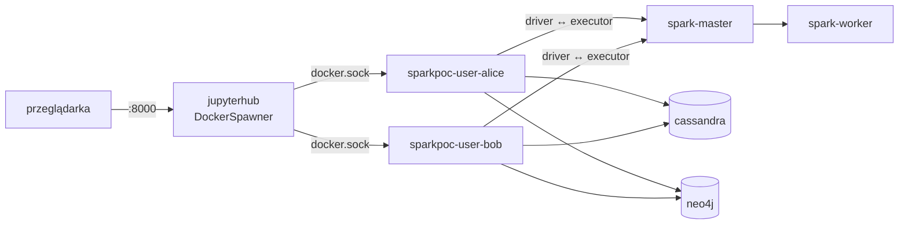

# PoC: Spark 4 + JupyterHub + Cassandra + Neo4j w Docker Compose

Pełne podsumowanie PoC (architektura, wyniki, pytania): [PODSUMOWANIE.md](PODSUMOWANIE.md).

Cel: sprawdzić, czy zestaw w ogóle działa razem (wersje, sieć driver ↔ executor, kernel Scala, connectory) i jak wygląda model „kontener na studenta". Nie jest to wersja docelowa: zamiast LDAP jest wspólne hasło, zamiast NFS jest lokalny wolumen, a Hub ma dostęp do gniazda Dockera.

## Szybki start (jedna komenda)

Wymagania: Docker (Desktop lub Engine z `docker compose` v2), ok. 6 GB RAM dla Dockera, ok. 10 GB na dysku.

```bash
git clone https://github.com/gmikx/spark-poc.git
cd spark-poc/compose
./demo.sh
```

Skrypt tworzy `.env`, buduje obrazy i uruchamia cały stos (JupyterHub z LDAP, Spark, Cassandra, Neo4j, dashboard topologii). Pierwszy raz trwa to kilka do kilkunastu minut. Na końcu wypisuje adresy i konta:

| Usługa | Adres |
|---|---|
| JupyterHub | http://localhost:8000 (`4alice` / `alice123` jako admin, `4bob` / `bob123`) |
| Dashboard topologii | http://localhost:8088 |
| Spark Master UI | http://localhost:8080 |

Domyślnie `demo.sh` startuje też **dodatkowy node obliczeniowy**: osobny kontener w osobnej sieci Dockera, który łączy się z klastrem tak jak zdalna maszyna, przez tunel L3 (wss → ssh), i dopiero tam dostaje adres `10.77.0.200`. W Spark Master UI i w dashboardzie widać wtedy dwóch workerów, a executory zadań trafiają na oba. Można to wyłączyć opcją `--no-node` (mniej RAM-u).

Pozostałe komendy: `./demo.sh --nfs` (dodatkowo symulowany NFS), `./demo.sh status`, `./demo.sh down` (zatrzymanie), `./demo.sh clean` (zatrzymanie i usunięcie danych). Dokładanie zdalnych node'ów wymaga serwera z `compose.cluster.yaml` (patrz niżej).

## Instalacja na serwerze (`stack.sh`)

Odpowiednik `demo.sh` dla instalacji na stałe (LDAP + NFS, porty domyślnie z `BIND_ADDR`, patrz `.env.example`):

```bash
cp compose/.env.example compose/.env     # ustaw własne hasła i BIND_ADDR=127.0.0.1
./stack.sh up            # pierwsze uruchomienie (buduje obrazy)
./stack.sh status        # kontenery, workery Spark, sesje studentów
./stack.sh stop          # zatrzymanie (dane zostają); ./stack.sh start wznawia
```

`stack.sh` dba o kolejność (serwer NFS musi działać przed hubem) i usuwa kontenery sesji studentów przy zatrzymaniu. Zestaw plików compose można zmienić w `.env` (`STACK_FILES`). Skrypt leży w korzeniu repo, a `.env` w `compose/`.

## Uruchomienie (ręcznie, wersja bez LDAP)

```bash
cd compose
docker compose up -d --build
```

| Usługa | Adres |
|---|---|
| JupyterHub | http://localhost:8000 (użytkownicy `alice`, `bob`, `admin`; hasło `poc`) |
| Spark Master UI | http://localhost:8080 |
| Neo4j Browser | http://localhost:7474 (`neo4j` / `pocpassword`) |

Parametry (zasoby, hasła, lista użytkowników) są w zmiennych środowiskowych, patrz `compose.yaml` i `.env.example`. Zatrzymanie: `docker compose down` (dodaj `-v`, żeby usunąć dane).

## Architektura PoC



Jeden obraz `sparkpoc/spark-node` służy jako master, worker i serwer użytkownika. Dzięki temu Spark, Java i Python są identyczne wszędzie. To ważne, bo PySpark wymaga zgodnej wersji Pythona na driverze i w executorach.

## Wyniki testów (Spark 4.0.0, Java 17, Python 3.10, Scala 2.13.16)

| Test | Wynik |
|---|---|
| Start całego stosu | działa |
| JupyterHub tworzy kontener per użytkownik z limitem RAM/CPU | działa |
| PySpark: driver w kontenerze studenta, executory na workerze | działa, w tym UDF w Pythonie |
| Kernel Scala (Almond 0.14.1, Scala 2.13.16) + Spark 4 na klastrze | działa, o ile do classpath dodać jary z `/opt/spark/jars` (patrz niżej) |
| Cassandra z Pythona (`cassandra-driver`) | działa |
| Neo4j z Pythona (`neo4j`) | działa |
| Connector Cassandry `spark-cassandra-connector_2.13:3.5.1` na Sparku 4.0.0 | **odczyt i zapis działają** w prostym teście. Connector nie ma oficjalnego wydania dla Sparka 4 (najnowszy 3.5.1 z czerwca 2024), więc to ryzyko na dalszą metę |
| Connector Neo4j `6.0.0_for_spark_4` | działa (odczyt zapytania) |

### Scala w Jupyterze

Zwykłe `import $ivy.org.apache.spark::spark-sql:4.0.0` często powoduje konflikty classpath. Zadziałało podejście z jarami klastra:

```scala
import java.nio.file.{Files, Paths}
import scala.jdk.CollectionConverters._
Files.list(Paths.get("/opt/spark/jars")).iterator.asScala
  .filter(_.toString.endsWith(".jar")).foreach(p => interp.load.cp(os.Path(p)))
```

Potem normalne `SparkSession.builder()...getOrCreate()`. Warto to wstawić do startowej komórki kernela lub konfiguracji Almonda, żeby studenci tego nie robili ręcznie.

## Ograniczenia i rzeczy do zrobienia

- Brak LDAP (wspólne hasło). Docelowo `ldapauthenticator` i grupa LDAP kursu.
- Katalog domowy to wolumen Dockera. Docelowo NFS z `--user <uid>:<gid>` z LDAP (patrz `PODSUMOWANIE.md`).
- Konta w Cassandrze i Neo4j nie są tworzone automatycznie (hook po logowaniu).
- Brak TLS i reverse proxy.
- Test zasobów: nie sprawdzano zachowania przy 16 równoległych sesjach. Obecnie `spark.cores.max=1` na aplikację, worker ma 2 rdzenie i 2 GB (pod laptop z 8 GB dla Dockera).
- Connectory Cassandry i Neo4j są pobierane z Mavena w czasie działania (`spark.jars.packages`). W docelowym środowisku lepiej zawrzeć jary w obrazie.
- Hub z gniazdem Dockera to ryzyko bezpieczeństwa (socket proxy lub rootless Docker w wersji docelowej).

## Wersja z LDAP (`compose.ldap.yaml`)

Nakładka na podstawowy `compose.yaml`. Używa tych samych obrazów i wolumenów. Dochodzi tylko `osixia/openldap` (ok. 370 MB), a obraz huba dostaje dodatkową bibliotekę (`jupyterhub-ldapauthenticator`) w tej samej konfiguracji (`AUTH_MODE=ldap`).

```bash
cd compose
docker compose -f compose.yaml -f compose.ldap.yaml up -d --build
# powrót do wersji bez LDAP:
docker compose up -d --build jupyterhub   # i: docker compose rm -sf openldap
```

Konta testowe (naśladują układ z Taurusa: login `4nazwisko`, UID `<rok><numer>`, GID rocznika, home `/home/stud<rok>/<login>`):

| Login | Hasło | Grupa `sparkusers` | UID:GID |
|---|---|---|---|
| `4alice` (admin Huba) | `alice123` | tak | 2024001:2024 |
| `4bob` | `bob123` | tak | 2024002:2024 |
| `4carol` | `carol123` | **nie** (ma być odrzucona) | 2023017:2023 |

### Co działa (przetestowane)

| Test | Wynik |
|---|---|
| Logowanie `4alice` i `4bob` | działa |
| `4carol` (poprawne hasło, brak grupy) i złe hasło | odrzucone |
| Kontener studenta uruchamiany z UID:GID z LDAP | działa (`uid=2024001(4alice) gid=2024(g2024)`) |
| Katalog domowy `/home/stud2024/<login>` na wspólnym wolumenie, pliki z właściwym właścicielem | działa (symuluje NFS) |
| PySpark (+UDF), kernel Scala, connectory Cassandry i Neo4j jako zwykli użytkownicy | działa |

### Znaleziska, które mogą dotyczyć prawdziwego środowiska

1. **Login zaczynający się od cyfry** (`4giza`) jest domyślnie odrzucany przez `ldapauthenticator` (`valid_username_regex`). Trzeba rozluźnić wyrażenie regularne. Zrobione w konfiguracji.
2. **Sprawdzanie grupy odbywa się z uprawnieniami samego użytkownika.** Jeśli zwykły użytkownik nie może czytać grup w LDAP (domyślne ACL w tym obrazie tak blokują), grupa nigdy nie „pasuje" i logowanie jest odrzucane bez czytelnego komunikatu. W PoC dodano ACL pozwalający czytać `ou=groups` (`ldap/02-security.ldif`). **To pytanie do administratora LDAP:** czy zalogowany użytkownik widzi członków grup, czy jest atrybut `memberOf` na własnym wpisie.
3. **Dowolny UID bez wpisu w `/etc/passwd` w kontenerze** psuje Sparka. Java widzi `user.home=?`, a Hadoop zgłasza `invalid null input: name`. Rozwiązanie w PoC: `libnss-wrapper` oraz pliki passwd/group generowane przez Hub przy starcie sesji. W produkcji alternatywą jest SSSD udostępniony do kontenera lub uruchamianie kontenerów z passwd z hosta.
4. **Katalog roboczy kontenera** musi być zapisywalny dla UID studenta (Spark tworzy `artifacts` w bieżącym katalogu). Ustawiony na home użytkownika.
5. **Konfiguracja Huba nie może leżeć w wolumenie `hub-data`**, bo Docker kopiuje do nowego wolumenu zawartość obrazu tylko raz i późniejsze zmiany obrazu są ignorowane. Config trafił do `/etc/jupyterhub/`.

### Automatyczne konta w Cassandrze

Nakładka włącza w Cassandrze `PasswordAuthenticator` i `CassandraAuthorizer`. Hook huba przy starcie sesji (idempotentnie):
1. tworzy rolę `u<login>` (np. `u4alice`, jak `u4nazwisko` w Postgresie na Pascalu) z hasłem wyliczonym jako HMAC z sekretu huba (nie trzeba nigdzie przechowywać haseł),
2. tworzy keyspace o tej samej nazwie i nadaje roli uprawnienia tylko do niego. Prefiks `u` jest celowy: nazwa zaczynająca się od cyfry (`4alice`) działa, ale w CQL trzeba ją ujmować w cudzysłów (`SELECT * FROM "4alice".notes`), a bez cudzysłowu jest błąd składni. To pytanie do administratora (26),
3. przekazuje do kontenera studenta `CASSANDRA_USER`, `CASSANDRA_PASSWORD`, `CASSANDRA_KEYSPACE` (+ `CASSANDRA_HOST`).

Przetestowane: student czyta i pisze we własnym keyspace (z Pythona i przez connector Sparka z `spark.cassandra.auth.*`), a próba odczytu cudzego keyspace i utworzenia nowego jest odrzucana (`Unauthorized`). Ponowne uruchomienie sesji nie psuje niczego. Uwaga: Cassandra 5 blokuje zmianę hasła tej samej roli częściej niż co 5 s, więc hook celowo nie robi `ALTER ROLE`. Admin używa w PoC domyślnego `cassandra`/`cassandra` (do zmiany).

### Neo4j Community

Działa: Bolt z Pythona, odczyt i zapis przez connector Sparka (`6.0.0_for_spark_4`), Neo4j Browser (port 7474). Ograniczenia edycji Community: jedna baza (`CREATE DATABASE` jest niedostępne), a `CREATE USER` działa, ale konta nie mają ról, więc **nie ma izolacji między użytkownikami**. Każdy widzi wszystko. Izolację można zapewnić tylko konwencją (np. etykiety z prefiksem studenta). Haków do Neo4j nie dodano.

### Zamykanie sesji i zasoby

- Wylogowanie zatrzymuje i usuwa kontener studenta (`shutdown_on_logout`). Przetestowane.
- Studenci często zamykają kartę bez wylogowania, więc działa też `idle-culler` (domyślnie 60 min bez aktywności, parametr `USER_IDLE_TIMEOUT`) oraz zabijanie bezczynnych kerneli po 30 min (`KERNEL_IDLE_TIMEOUT`). Kernel trzyma sesję Sparka, a ta w trybie standalone blokuje rdzenie workera, więc to ważniejsze niż samo zatrzymanie kontenera.
- **`spark-defaults.conf` nie działa w kernelu Scala.** Plik czyta `spark-submit`, a PySpark go używa. Almond uruchamia Sparka w swojej JVM i go pomija. Obejście: przy budowie obrazu skrypt przepisuje `spark-defaults.conf` na argumenty `-Dspark.*` w `kernel.json` kernela Scala (Spark czyta właściwości systemowe). Dzięki temu jeden plik rządzi PySparkiem i Scalą. Wyjątek: `spark.driver.memory` (nie działa jako właściwość systemowa, bo JVM już działa).
- Dodatkowe zabezpieczenie na masterze: `SPARK_MASTER_OPTS=-Dspark.deploy.defaultCores=1` (parametr `SPARK_DEFAULT_CORES`) obowiązuje klientów, którzy sami nie ustawią `spark.cores.max`.

### Dynamic allocation (skalowanie executorów do 0)

W `singleuser/spark-defaults.conf`: `minExecutors=0`, `maxExecutors=2`, 1 rdzeń na executor, `executorIdleTimeout=60s`, `shuffleTracking.timeout=120s`, `cachedExecutorIdleTimeout=300s`. Student bez pracy po ok. 1-2 minutach nie zajmuje żadnych rdzeni, a kolejna komórka sama przywraca executor.

Przetestowano (z skróconymi limitami czasu 10 s) w PySparku i w Scali: 0 executorów na starcie, 1 po zadaniu, **0 po bezczynności**, 1 po kolejnym zadaniu. Pierwsze zadanie po przerwie trwa ok. 2,4 s dłużej (start executora).

Ważne: bez ustawienia `shuffleTracking.timeout` executor, który wykonał agregację (shuffle), **nie jest zwalniany** (domyślnie bez limitu), a prawie każde zapytanie studenta ma shuffle. Zwolnienie executora z danymi shuffle lub cache oznacza ich ponowne przeliczenie, jeśli kolejna akcja z nich skorzysta (poprawność zachowana).

### Czego nadal nie ma
- StartTLS/LDAPS (w PoC `tls_strategy=insecure`, bo LDAP jest w sieci Dockera),
- prawdziwego NFS (zamiast niego wolumen Dockera zamontowany pod `/home`),
- konta serwisowego tylko do odczytu (PoC używa admina LDAP do pobrania UID/GID).

## Wersja z NFS (`compose.nfs.yaml`)

Symuluje najtrudniejszy przypadek, czyli filer jak na Taurusie: **NFSv4.2, `sec=sys`, `root_squash`, eksport po adresie IP klienta, opcje montowania `hard`/`local_lock=none`**, a katalogi domowe istnieją wcześniej i należą do UID z LDAP. Serwer to mały obraz Alpine z `nfs-utils` (kernelowy nfsd z maszyny wirtualnej Dockera Desktop, kontener jest `privileged`).

```bash
cd compose
F="-f compose.yaml -f compose.ldap.yaml -f compose.nfs.yaml"
docker compose -f compose.yaml -f compose.ldap.yaml down     # przy pierwszym przełączeniu: zmienia się podsieć sparkpoc_net
docker rm -f sparkpoc-user-4alice sparkpoc-user-4bob 2>/dev/null
docker compose $F up -d nfs      # NFS musi działać, zanim Docker zamontuje wolumen
docker compose $F up -d
```

Montowanie robi demon Dockera przy tworzeniu kontenera (wolumen `type: nfs`), czyli analogicznie do `/etc/fstab` na hoście VM. Dlatego serwer NFS musi wystartować wcześniej, a nie tylko „przed startem" Huba (`depends_on` nie wystarcza, bo wolumen jest montowany przy `create`).

### Przetestowane

| Test | Wynik |
|---|---|
| Montowanie `/home` w Hubie i kontenerach: NFSv4.2, `sec=sys`, `hard`, `local_lock=none` | działa (opcje jak na Taurusie) |
| `root_squash`: Hub (root) nie może tworzyć ani zapisywać w katalogach studentów | potwierdzone (`Permission denied`) |
| Student zapisuje do własnego `/home/stud2024/<login>`, nie zapisze do cudzego (755) | zgodnie z oczekiwaniem; właściciele widoczni jako UID z LDAP |
| PySpark (+UDF), kernel Scala, Cassandra z kontem per student na katalogu domowym na NFS | działa |
| Awaria serwera NFS (`hard`): operacje na `/home` **zawieszają się** | potwierdzone |
| Powrót serwera NFS | I/O wraca po ok. **95 s** (okres karencji NFSv4, 90 s), bez zrywania kontenerów |

### Zmiany w konfiguracji wynikające z NFS

1. **Hub nie może tworzyć ani zmieniać właściciela katalogów domowych** (`root_squash`). Katalogi muszą istnieć wcześniej na filerze. Hook zgłasza czytelny błąd, jeśli katalogu brakuje. Ważne pytanie do administratora: kto i jak tworzy katalogi domowe nowych studentów (np. `pam_mkhomedir` na Taurusie).
2. **Pliki passwd/group dla `libnss-wrapper` nie mogą leżeć w katalogu domowym** (root nie ma tam prawa zapisu). Przeniesione na lokalny wolumen `nss` (`/nss/<login>.passwd`), montowany read-only do kontenerów studentów. Dotyczy też wersji LDAP bez NFS.
3. **Nazwa wolumenu domów jest parametrem** (`HOMES_VOLUME`), a konfiguracja Huba nie zakłada już lokalnego wolumenu.
4. Serwer NFS musi eksportować korzeń NFSv4 (`fsid=0`) z systemu plików innego niż overlayfs. W PoC to `tmpfs` z `/export/home` podpiętym z wolumenu, a klient montuje `:/home`.

### Ograniczenia symulacji
- Docker Desktop (VM z Linuksem): serwer i klient dzielą jądro. Zachowanie przy utracie sieci między osobnymi maszynami może być bardziej dokuczliwe.
- Nie symulujemy kwot, zapełnienia dysku, Kerberosa ani ograniczenia eksportu do pojedynczych adresów hostów (eksport dla całej podsieci `172.28.0.0/24`).

## Dashboard topologii i dodatkowe node'y

Dashboard (`dashboard/`, port 8088) rysuje graf kontenerów sieci `sparkpoc_net` (zależności z `depends_on`, notebooki użytkowników, workery zarejestrowane w masterze Sparka). Workery z innych maszyn pojawiają się same, w osobnej ramce node'a (nazwy w `NODE_NAMES`).

Serwer główny (`compose.cluster.yaml` dodaje wejście dla node'ów):

```bash
cd compose
echo "WAN_PATH_SECRET=$(openssl rand -hex 16)" > .env
docker compose -f compose.yaml -f compose.cluster.yaml up -d --build
```

Dołączany node (inna maszyna, wymaga `wan/id_ed25519`, którego klucz publiczny jest w `wan/authorized_keys` na serwerze):

```bash
cp .env.node.example .env.node   # NODE_IP, WAN_URL, WAN_PATH_SECRET
docker compose -p sparkpoc-node -f compose.node.yaml --env-file .env.node up -d --build
```

Transport: wss (wstunnel, przez nginx na `nas`) -> `ssh -w` (tun L3) -> kontener `wan-gw` z proxy-ARP, który wystawia `NODE_IP` w podsieci `10.77.0.0/24`. Dzięki temu driver, executory i master widzą się po zwykłych adresach IP. Sprawdzone: job PySpark z executorami na obu node'ach. Szablony vhostów nginx: `nginx/`.
